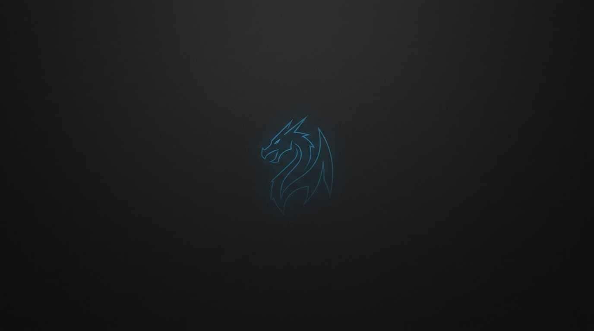

# Kali Linux & Debian i3 Customization Dotfiles

Modern, lightweight, and aesthetic i3wm setup customized for **Kali Linux** and **Debian 12+ (Bookworm / Testing)**.



---

## 🚀 Features

- **Window Manager:** i3 with native gaps support (`i3-gaps`).
- **Terminal:** Alacritty GPU-accelerated terminal (support for modern `alacritty.toml` & legacy `alacritty.yml`).
- **Status Bar:** i3bar + i3blocks with dynamic CPU, RAM, Disk, Dynamic Bandwidth, and VPN/Local IP indicators.
- **Compositor:** Modern `picom` optimized for clean shadows, fading, and window transparency without VM glitches.
- **App Launcher:** Rofi with modern `.rasi` configuration and fuzzy application search.
- **VM Integration:** Out-of-the-box clipboard and resolution auto-fix for VMware and VirtualBox.
- **Audio & Brightness:** Multimedia keybindings support.

---

## 🛠️ Quick Installation

Clone this repository to your Kali Linux or Debian system:

```bash
git clone https://github.com/Sathira-Laksahan/Customization-i3.git
cd Customization-i3
bash installer.sh
```

---

## 🔄 Updating in the Future

Once installed, you **never** need to reinstall from scratch or re-download packages/fonts. To update your dotfiles and scripts:

### Option 1: Global Terminal Command (Recommended)
Simply open any terminal in Kali and run:
```bash
i3-update
```
*(This pulls latest changes from GitHub, deploys updated dotfiles, and reloads i3 live without logging out!)*

### Option 2: Using the Updater Script
Inside the repository folder:
```bash
bash update.sh
```
Or with CLI flags:
```bash
bash installer.sh --update       # Local dotfiles update
bash installer.sh --git-update   # Pull from GitHub & update
```

---

## 🖥️ First Boot Setup

1. **Reboot** or **Log out** of your current desktop session.
2. At the login screen (LightDM / GDM), click the session gear icon and select **`i3`**.
3. Log in to your session.
4. Press **`Win + Enter`** to launch the Alacritty terminal.
5. In the terminal, run `lxappearance`:
   - Set **Widget Theme** to **`Arc-Dark`**.
   - Set **Icon Theme** to **`Papirus-Dark`**.
   - Click **Apply**.

---

## ⌨️ Keybindings & Shortcuts

| Shortcut | Action |
| :--- | :--- |
| **`Win + Enter`** | Open Alacritty Terminal |
| **`Win + d`** | Open Rofi Application Launcher |
| **`Win + Shift + q`** | Close / Kill focused window |
| **`Win + Shift + Return`** | Open Thunar File Manager |
| **`Win + Shift + w`** | Open Wallpaper Switcher (Rofi GUI) |
| **`Win + P`** | Take screenshot with Flameshot |
| **`Win + j / k / l / ;`** or **Arrow Keys** | Focus window (Left, Down, Up, Right) |
| **`Win + Shift + j / k / l / ;`** or **Shift + Arrows** | Move window position |
| **`Win + 1 .. 0`** | Switch to Workspace 1 - 10 |
| **`Win + Shift + 1 .. 0`** | Move focused window to Workspace 1 - 10 |
| **`Win + f`** | Toggle Fullscreen |
| **`Win + Shift + Space`** | Toggle Floating mode |
| **`Win + h` / `Win + v`** | Split layout horizontally / vertically |
| **`Win + r`** | Enter Resize mode (Escape to exit) |
| **`Win + Ctrl + Shift + Arrows`** | Quick window resize |
| **`Win + Shift + c`** | Reload i3 configuration |
| **`Win + Shift + r`** | Restart i3 in-place |
| **`Win + Shift + x`** | Lock screen |
| **`Win + Shift + e`** | Exit i3 (Logout prompt) |
| **Audio Keys (`XF86Audio...`)** | Volume Up / Down / Mute |
| **Brightness Keys** | Screen brightness adjustment |

---

## 🖼️ Wallpaper Management

This setup comes with **5 curated, aesthetic dark minimal wallpapers**:

1. **`1` - Cyan Horizon:** Deep obsidian with a subtle neon cyan horizon.
2. **`2` - Kali Dragon (Default):** Matte dark charcoal with a minimal neon Kali dragon stencil.
3. **`3` - Night Mountains:** Flat vector night mountain ridge under a starlit horizon.
4. **`4` - Penrose Geometry:** Pitch-black background with impossible Penrose geometry.
5. **`5` - Dark Stardust:** Deep charcoal background with subtle minimal stardust.

### How to Switch Wallpaper:

- **Graphical Menu (GUI):**
  Press **`Win + Shift + w`** anywhere on your desktop to open the Rofi wallpaper picker.

- **Terminal Command:**
  Run `set-wallpaper` from any terminal:
  ```bash
  set-wallpaper 2                     # Set Kali Dragon
  set-wallpaper 1                     # Set Cyan Horizon
  set-wallpaper ~/Downloads/my_bg.jpg # Set ANY custom image!
  set-wallpaper                       # Interactive selection menu
  ```

- **Via Installer Flag:**
  ```bash
  bash installer.sh -w 3              # Set wallpaper 3
  bash installer.sh -w /path/to/image # Set custom wallpaper
  ```

---

## 💻 Terminal Prompt Customization

Choose between **4 terminal prompt styles** anytime:

| Style | Description | Preview |
|---|---|---|
| **`arrow` (Default)** | Modern Oh-My-Zsh Minimal Arrow | `➜  ~ ` |
| **`classic`** | Standard Linux prompt (Green user, Red root) | `kali@kali:~$ ` / `root@kali:~# ` |
| **`kali`** | Iconic Kali Linux Two-Line prompt | `┌──(kali㉿kali)-[~]`<br>`└─$ ` |
| **`compact`** | Compact brackets prompt | `[kali@kali ~]$ ` |

### How to Switch Terminal Prompt:

- **Instant Terminal Commands:**
  Run directly inside your terminal:
  ```bash
  prompt-classic    # Switch to classic user@kali:~$
  prompt-kali       # Switch to iconic Kali prompt
  prompt-arrow      # Switch to minimal arrow (Default)
  prompt-compact    # Switch to compact
  ```

- **Global CLI Command:**
  ```bash
  set-prompt classic       # Set classic prompt
  set-prompt kali          # Set Kali two-line prompt
  set-prompt arrow         # Set minimal arrow
  set-prompt               # Interactive menu
  ```

- **Via Installer Flag:**
  ```bash
  bash installer.sh --prompt classic
  bash installer.sh -p kali
  ```

---

## 🎨 Customization

- **Transparency & Effects:**
  Edit `~/.config/picom/picom.conf` to customize window blur, fading speed, and opacity rules.
- **Status Bar Widgets:**
  Custom status bar scripts are located in `~/.config/i3/scripts/`. Edit `~/.config/i3/i3blocks.conf` to add or modify widgets.
- **Terminal Theme & Font:**
  Edit `~/.config/alacritty/alacritty.toml` (or `alacritty.yml`).


